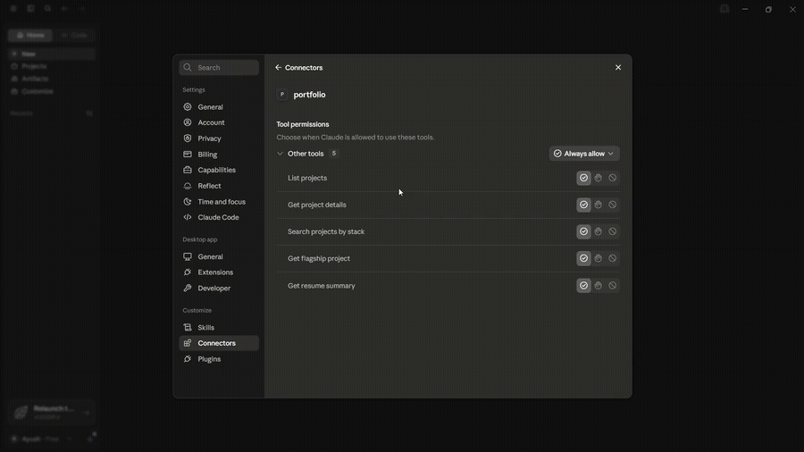
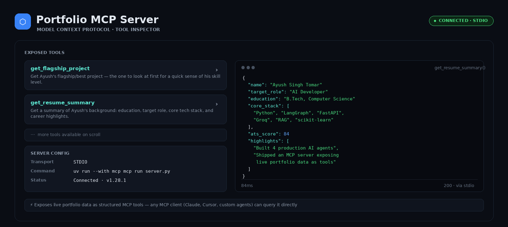
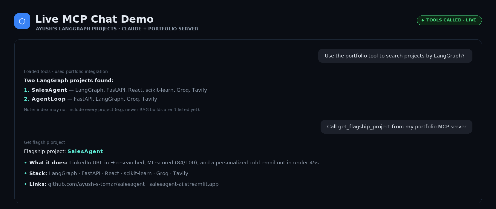

<div align="center">

# Portfolio MCP Server

**An MCP server that turns my AI project portfolio into something you can *query*, not just read.**

Point any MCP client (Claude Desktop, Cursor, custom agents) at it and ask
*"What has Ayush built with LangGraph?"* or *"What's his flagship project?"*
— it answers from live structured data, not a static PDF.

[](LICENSE)
[](https://www.python.org/downloads/)
[](https://pypi.org/project/portfolio-mcp-server/)
[](https://modelcontextprotocol.io)
[](https://github.com/ayush-s-tomar/portfolio-mcp-server/actions/workflows/ci.yml)
[](https://github.com/astral-sh/ruff)
[](CONTRIBUTING.md)

**TL;DR**
- 📦 **Published, not just built** — live on PyPI and the official MCP registry; `pip install portfolio-mcp-server` gets it running in any MCP client in under a minute, no repo clone required.
- 🔧 **5 real tools** — list, detail-lookup, stack search, flagship pick, and resume summary, all backed by structured data instead of a static README scroll.
- ✅ **CI-tested on every push** — lint, type-check, and a real stdio smoke test that calls all 5 tools and validates the JSON schema of each response.



</div>

---

## Table of contents

- [Why this exists](#why-this-exists)
- [Demo](#demo)
- [Tools exposed](#tools-exposed)
- [Quickstart](#quickstart)
- [Connect to Claude Desktop](#connect-to-claude-desktop)
- [Stack](#stack)
- [Testing & CI](#testing--ci)
- [Project structure](#project-structure)
- [Known limitations](#known-limitations)
- [Roadmap](#roadmap)
- [License](#license)
- [Author](#author)

## Why this exists

Most AI-developer portfolios are a list of links. This is a working MCP
server — the same protocol agentic products use to connect to tools — built
around my own portfolio. It's both a real implementation of the spec and an
answer to *"show me you've actually built with MCP,"* not just talked about it.

## Demo

| MCP Inspector — tool discovery | Live chat demo |
|---|---|
|  |  |

<details>
<summary><b>🎥 Full video walkthrough</b></summary>
<br/>

https://github.com/user-attachments/assets/4c1b844a-087f-48a6-b156-bdef27282acc

*Setup → tool calls → live answers, end to end.*

</details>

## Tools exposed

| Tool | Description |
|---|---|
| `list_projects` | Short summary of all 9 projects |
| `get_project_details(project_name)` | Full details for one project |
| `search_projects_by_stack(technology)` | Find projects using a given technology |
| `get_flagship_project` | The single best project to look at first |
| `get_resume_summary` | Background, target role, and core stack |

## Quickstart

**Option A — install from PyPI (fastest):**

```bash
pip install portfolio-mcp-server
```

**Option B — clone and run from source (for local edits/testing):**

```bash
git clone https://github.com/ayush-s-tomar/portfolio-mcp-server.git
cd portfolio-mcp-server

python -m venv venv
source venv/bin/activate        # Windows: venv\Scripts\activate

pip install -r requirements.txt
```

Test it interactively with the MCP Inspector before wiring it into a client:

```bash
mcp dev server.py
```

This opens a browser UI where you can call each tool manually and inspect
raw request/response payloads.

## Connect to Claude Desktop

Open your Claude Desktop config file:

| OS | Path |
|---|---|
| macOS | `~/Library/Application Support/Claude/claude_desktop_config.json` |
| Windows | `%APPDATA%\Claude\claude_desktop_config.json` |

If the file already has an `mcpServers` key with other servers in it, add
the `"portfolio"` entry inside the existing object rather than overwriting
the file.

**If you installed via PyPI (Option A above):**

```json
{
  "mcpServers": {
    "portfolio": {
      "command": "portfolio-mcp-server"
    }
  }
}
```

**If you're running from a cloned source checkout (Option B above):** use the **absolute path** to `server.py` on your machine:

```json
{
  "mcpServers": {
    "portfolio": {
      "command": "python",
      "args": ["/absolute/path/to/portfolio-mcp-server/server.py"]
    }
  }
}
```

Restart Claude Desktop, then ask it something like:

> "What projects has Ayush built with FastAPI?"

Claude will call `search_projects_by_stack` and answer from the live data.

## Stack

- **Python 3.10+**
- **[MCP Python SDK](https://github.com/modelcontextprotocol/python-sdk)** (`FastMCP`)
- **stdio transport**
- **Packaged for PyPI** and registered on the official [MCP server registry](https://modelcontextprotocol.io) (`io.github.ayush-s-tomar/portfolio-mcp-server`)

## Testing & CI

Every push and pull request runs through GitHub Actions:

- **Lint** — `ruff check .`
- **Type check** — `mypy server.py`
- **Smoke test** — spins up the server and calls each of the 5 tools over
  stdio to confirm they return valid, schema-matching JSON

See [`.github/workflows/ci.yml`](.github/workflows/ci.yml). Run the same
checks locally before opening a PR:

```bash
pip install -r requirements-dev.txt
ruff check .
mypy server.py
pytest
```

## Project structure

```text
portfolio-mcp-server/
├── server.py              # FastMCP server + tool definitions
├── data/
│   └── projects.json      # Project data the tools read from
├── tests/
│   └── test_tools.py      # Smoke tests for each tool
├── requirements.txt
├── requirements-dev.txt
├── pyproject.toml         # PyPI packaging config
├── server.json             # MCP registry manifest
└── .github/workflows/ci.yml
```

## Known limitations

- **Static project data** — tools read from `data/projects.json`, so adding or updating a project means editing that file and republishing, not a live sync with the actual GitHub repos or portfolio site (see [Roadmap](#roadmap) — a refresh endpoint isn't built yet).
- **stdio transport only** — works great for local MCP clients like Claude Desktop that can spawn the process directly, but there's no HTTP/SSE option yet for a client that needs to reach it remotely over the network.
- **`search_projects_by_stack` matches one technology at a time** — asking for projects using both LangGraph *and* FastAPI together isn't supported yet; each call filters on a single technology.

## Roadmap

- [x] Publish to PyPI as an installable package
- [x] Publish to the official MCP server registry
- [ ] `search_projects_by_stack` — support matching on multiple technologies at once
- [ ] Add an HTTP/SSE transport option alongside stdio for remote clients
- [ ] Cache resume/project data with a lightweight refresh endpoint instead of static JSON

## License

Released under the [MIT License](LICENSE).

## Author

**Ayush Singh Tomar** — [GitHub](https://github.com/ayush-s-tomar) · [LinkedIn](https://www.linkedin.com/in/ayushsinghtomar) · [Portfolio](https://ayush-s-tomar.vercel.app)

If this was useful as a reference for building your own MCP server, a ⭐ on the repo is appreciated.


mcp-name: io.github.ayush-s-tomar/portfolio-mcp-server
